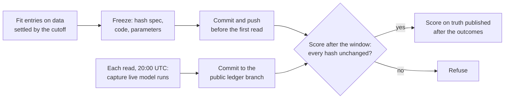

# forward

[](https://github.com/physicalreasoning/forward/actions/workflows/ci.yml)
[](LICENSE)


**Sealed forward tests for world models.** Every entry is frozen and hashed before a round opens,
then scored only on outcomes that resolve after the freeze. Nothing can leak into training, and
nothing can be tuned after the fact.

Most world-model benchmarks score how generated video looks; forecasting benchmarks score
language models on real outcomes. `forward` scores models of real systems (the atmosphere, asset
prices) on real outcomes, and every entry reports the same six columns:

| # | Column | Why it is there |
| --- | --- | --- |
| 1 | Proper score (log score, RPS) with date-block CIs | the headline number, honestly uncertain |
| 2 | Calibration (PIT, interval coverage) | a sharp model that is wrong 20% of the time at 95% is not usable |
| 3 | Skill against copying the last value, and climatology | a model that learns to copy its input looks healthy on every other diagnostic ([causal-jepa](https://github.com/physicalreasoning/causal-jepa)) |
| 4 | Skill against the prediction market on the same outcome, at its bid | the hardest baseline available: everyone with money on the line |
| 5 | Decision value: paper P&L after fees and slippage | a better score is not a better decision ([isotherm](https://github.com/physicalreasoning/isotherm) §49) |
| 6 | Share of the gain one calendar month explains | a lucky regime is not skill |

## Results so far

Both are **dry runs** on past data: the pipeline is the sealed one, but the outcomes were known
when it was built. The dry run's model inputs are Open-Meteo's archived previous-day runs, each
from the run started 24 hours before the hour it forecasts; for afternoon hours that run appears
shortly after the 20:00 UTC read, so these inputs are a few hours fresher than a live capture can
be. That flatters every weather entry a little, the same way for each; the sealed rounds use
only what was captured at the read. The sealed rounds below test whether the findings hold on outcomes nobody
could have seen.

**Task 1, station highs** (19 NWS stations, 2026-07-01 to 2026-10-09, 1,917 station-days).
Log score difference per station-day, 95% date-block CI:

| Test | Result |
| --- | --- |
| Learned vs physics: calibrated AIFS minus calibrated IFS | **+0.133** [+0.089, +0.178] |
| Same, both used as they come | **-0.061** [-0.092, -0.029] |
| Every calibrated model minus copying yesterday | +0.41 to +0.76, all above zero |
| Five-model blend minus the bid-priced Kalshi market | -0.113 [-0.151, -0.075] |
| Blend's P&L per ladder after fees and 1c slippage | -$0.021 [-0.061, +0.019] |

ECMWF's learned model loses to its physics model out of the box and beats it once calibrated.
No entry beats the market that prices the same outcome.

**Task 2, price ladders** (S&P 500, Nasdaq-100, EUR/USD, USD/JPY, WTI, Brent, gold, silver,
copper, natural gas; 2,609 Kalshi ladders). Log score minus copying the last price:

| Model (zero-shot) | 24 h before close | 6 h before close |
| --- | --- | --- |
| Chronos-Bolt small | -0.046 [-0.100, +0.010] | -0.028 [-0.069, +0.010] |
| Chronos-Bolt base | -0.072 [-0.120, -0.020] | -0.020 [-0.056, +0.018] |
| TimesFM 2.5 | -0.059 [-0.103, -0.011] | -0.017 [-0.062, +0.026] |

No time-series foundation model beats copying. Their predicted moves point the right way 49 to
50% of the time, and keeping their direction with the copy baseline's spread makes every one
significantly worse.

**Task 3, fills under intervention** (in development). A counterfactual task: if we had placed a
limit order at a given price and size, would it have filled within 5 minutes, 30 minutes or 2
hours, and where did the price go next? The ground truth comes from replaying Kalshi order books
we record ourselves, so every action has a known outcome. The first pipeline check uses one
day of recordings; its intervals are not yet meaningful. Design, simulator assumptions and a
draft spec: [docs/TASK3_FILLS.md](docs/TASK3_FILLS.md).

Full tables: [results/LEADERBOARD.md](results/LEADERBOARD.md). Results page:
[physicalreasoning.ai/forward](https://physicalreasoning.ai/forward/).

## Rounds

| Round | Tasks | Fit through | Window | Status |
| --- | --- | --- | --- | --- |
| 1 | Station highs (with isotherm) | 2026-10-30 | 2026-11-01 to 2026-12-26 | [spec](ROUND1.md); freezes 2026-10-31 |
| 2 | Station highs; price ladders | 2027-01-02 | 2027-01-04 to 2027-02-28 | [spec](ROUND2.md); freezes 2027-01-03 |

Each spec states its hypotheses and pass rules before any of its data exists. Every result is
published, including failures. Round 1 also enters [isotherm](https://github.com/physicalreasoning/isotherm),
captured live from its public API at each read and scored on the ladders it covers against the
market (H5).

## How a round is sealed



The public commit times on `main` (the freeze) and `ledger` (each capture) are the evidence.
The capture runs on a maintainer's machine at 20:00 UTC, with a GitHub Actions backup
(`.github/workflows/capture.yml`) retrying until 21:42 UTC; whichever reaches `ledger` first is kept.
Rules and definitions: [docs/METHODS.md](docs/METHODS.md).

## Reproduce

```bash
uv sync                                           # Python 3.11+, uv
uv run pytest                                     # offline tests
uv run scripts/build_history.py                   # truth since 2010, model archives since 2024
uv run scripts/score.py --dry-run 2026-07-01 2026-10-09
uv run scripts/rehearse.py /tmp/ledger            # the sealed path on the same window: identical
uv sync --extra tsfm                              # Chronos and TimesFM (CPU is enough)
uv run --extra tsfm scripts/score_prices.py       # needs isotherm's data/bench/raw
uv run scripts/score_fills.py                     # task 3 pipeline check; needs isotherm's data/book
uv run scripts/leaderboard.py                     # results/LEADERBOARD.md from the JSON results
uv run scripts/site.py                            # the results page, site/index.html
```

The same steps under one command: `uv run forward list | capture | score | freeze | rehearse |
leaderboard | site` (arguments pass through to the script). To add an entry or a task,
`uv run forward new entry NAME` or `uv run forward new task NAME`; see
[docs/ADDING.md](docs/ADDING.md).

## Data and attribution

All inputs come from free sources, each under its own terms ([docs/DATA_TERMS.md](docs/DATA_TERMS.md)).
This repository publishes code, specs and aggregate scores; it does not republish Kalshi or Yahoo
data, which their terms do not allow. Fetch scripts download them on your machine.

- **Weather model runs:** [Weather data by Open-Meteo.com](https://open-meteo.com/), licensed
  [CC BY 4.0](https://creativecommons.org/licenses/by/4.0/). The `ledger` branch republishes the
  captured daily-maximum values, derived (local-day maximum of hourly runs) from that data.
- **ECMWF AIFS and IFS forecasts** (via Open-Meteo): Copyright © 2024-2026 European Centre for
  Medium-Range Weather Forecasts (ECMWF). Source: www.ecmwf.int. Licence: CC BY 4.0. ECMWF does
  not accept any liability for the accuracy or completeness of the data, for any errors, or for
  any direct or indirect consequences of using it.
- **Other upstream models** (via Open-Meteo): DWD ICON, CC BY 4.0; NOAA GFS and NBM, public domain.
- **NWS climate reports, MOS and observations** via the Iowa Environmental Mesonet: public domain.
- **Kalshi** (ladders, quotes, settlements) and **Yahoo Finance** (hourly prices): used for
  scoring only, not redistributed.

Kalshi requests are faster with an API key (`KALSHI_API_KEY_ID`, `KALSHI_PRIVATE_KEY_PATH`) but
do not need one.

## Layout

| Path | What |
| --- | --- |
| `forward/stations.py`, `truth.py`, `openmeteo.py`, `market.py`, `history.py` | task 1 data |
| `forward/prices.py`, `price_ladders.py`, `tsfm.py` | task 2 data and the foundation-model entries |
| `forward/registry.py` | every task and entry, declared in one place ([adding one](docs/ADDING.md)) |
| `forward/entries.py`, `isotherm_live.py` | task 1 entries: the fitted gaussian ones, and isotherm (live, ladder) |
| `forward/fills.py`, `fill_entries.py` | task 3: the counterfactual fill simulator and its entries |
| `forward/metrics.py` | the six columns |
| `forward/wm/`, `entries/wm1/` | the world-model track: captured ensembles, truth, scores, the WM-1 entry interface, runner and baselines ([design](docs/WORLD_MODEL_TRACK.md), [dry run](docs/WM1_DRYRUN.md)) |
| `forward/ledger.py`, `seal.py` | the capture deadline and the hash checks |
| `forward/cli.py`, `scaffold.py` | the `forward` command and its templates |
| `scripts/` | build, capture, freeze, score, rehearse, leaderboard, results page |
| `ROUND*.md` | pre-registered specs |
| `frozen/` | frozen rounds (from 2026-10-31) |
| `results/` | every result, as JSON, plus the leaderboard |

## Citation

See [CITATION.cff](CITATION.cff). Physical Reasoning, 2026. Apache-2.0.
