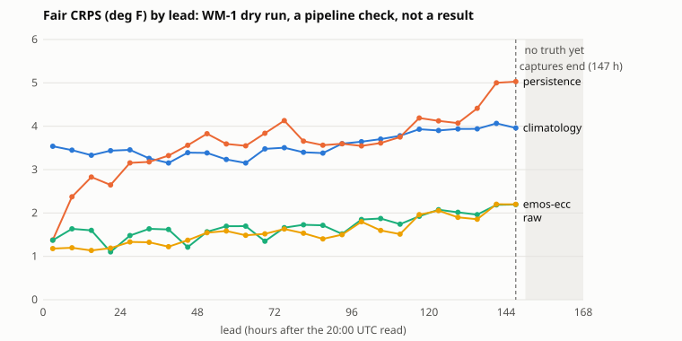

# WM-1 dry run

**A pipeline check, not a result.** 4 reads (2026-10-23 to 2026-10-26), 19 stations, truth to 2026-10-27 00:00 UTC. The baselines were written after these reads, so nothing here is sealed, and with this few inits the intervals (resampling whole init dates) mean little. Generated by `uv run scripts/wm1_dryrun.py` at 2026-10-27 01:56 UTC; numbers in `results/wm/wm1_dryrun.json`.

Task and scores: [WORLD_MODEL_TRACK.md](WORLD_MODEL_TRACK.md). Each entry submits 50 joint trajectories of hourly 2 m temperature per station for hours 1 to 168 after the 20:00 UTC read; truth is ASOS, the report nearest each hour within ten minutes. Every score is in deg F, lower is better, on the same cells for every entry.

## Entries

| Entry | What it is | Inputs |
| --- | --- | --- |
| `climatology` | past ten years' observed weeks at the same time of year, offsets up to two days | truth |
| `persistence` | today's anomaly from the diurnal climatology, plus analogue-week residuals | truth |
| `raw` | 50 members of the captured multi-model ensemble, equal weight per model | ensembles |
| `emos-ecc` | EMOS per lead block fit on captures verified before the init, reordered by ECC-Q | ensembles, truth |

## How much has verified

| Read | Hours with truth at every station (of 168) |
| --- | --- |
| 2026-10-23 | 70 |
| 2026-10-24 | 48 |
| 2026-10-25 | 25 |
| 2026-10-26 | 4 |

Leads every forecast covers: `climatology` 168, `persistence` 168, `raw` 147, `emos-ecc` 147. The captures hold seven calendar days from 00:00 UTC, so the ensemble entries stop at lead 147 (Findings).

## Energy score (primary) and variogram score, by window

Rows are (read, station) pairs whose whole window has verified. Windows with no rows yet are listed so the gap is visible. With one read an interval collapses to a point and with two or three it is not a measure of uncertainty; they are printed to exercise the code.

| Window | Reads | Rows | `climatology` energy | `persistence` energy | `raw` energy | `emos-ecc` energy |
| --- | --- | --- | --- | --- | --- | --- |
| 24 h | 3 | 53 | 18.36 [15.17, 21.53] | 13.82 [12.05, 14.91] | 8.13 [7.65, 8.45] | 7.25 [6.71, 8.25] |
| 48 h | 2 | 35 | 26.36 [23.84, 28.75] | 23.92 [23.84, 24.00] | 11.65 [11.62, 11.68] | 11.03 [10.59, 11.44] |
| 72 h | 1 | 17 | 32.90 [32.90, 32.90] | 32.27 [32.27, 32.27] | 14.39 [14.39, 14.39] | 14.23 [14.23, 14.23] |
| 96 h | 0 | 0 | n/a | n/a | n/a | n/a |
| 120 h | 0 | 0 | n/a | n/a | n/a | n/a |
| 144 h | 0 | 0 | n/a | n/a | n/a | n/a |
| 168 h | 0 | 0 | n/a | n/a | n/a | n/a |

| Window | `climatology` variogram (p = 0.5) | `persistence` variogram (p = 0.5) | `raw` variogram (p = 0.5) | `emos-ecc` variogram (p = 0.5) |
| --- | --- | --- | --- | --- |
| 24 h | 327.8 [301.2, 361.8] | 322.6 [297.1, 356.3] | 156.2 [145.7, 168.7] | 159.8 [150.2, 168.3] |
| 48 h | 1591.1 [1527.9, 1650.9] | 1575.4 [1516.1, 1631.4] | 699.9 [699.5, 700.3] | 710.8 [687.5, 735.3] |
| 72 h | 4056.9 [4056.9, 4056.9] | 4024.6 [4024.6, 4024.6] | 1675.9 [1675.9, 1675.9] | 1663.8 [1663.8, 1663.8] |

Energy score minus climatology's (negative is better), date-block 95% interval:

| Window | `persistence` | `raw` | `emos-ecc` |
| --- | --- | --- | --- |
| 24 h | -4.55 [-7.14, -3.12] | -10.23 [-13.20, -6.72] | -11.12 [-13.28, -8.42] |
| 48 h | -2.44 [-4.75, -0.00] | -14.71 [-17.13, -12.16] | -15.34 [-17.31, -13.25] |
| 72 h | -0.63 [-0.63, -0.63] | -18.51 [-18.51, -18.51] | -18.67 [-18.67, -18.67] |

## Fair CRPS and calibration, every verified hour

3027 station-hours with truth and a forecast from every entry. PIT coverage is the share of truths inside the central 50/80/90% sample interval (calibrated: 0.50, 0.80, 0.90); flatness is half the L1 distance of the 10-bin PIT histogram from uniform.

| Entry | Fair CRPS | Cover 50% | Cover 80% | Cover 90% | PIT flatness |
| --- | --- | --- | --- | --- | --- |
| `climatology` | 3.21 [2.93, 3.40] | 0.61 | 0.93 | 0.99 | 0.151 |
| `persistence` | 3.08 [2.23, 3.32] | 0.59 | 0.88 | 0.95 | 0.107 |
| `raw` | 1.47 [1.45, 1.53] | 0.54 | 0.84 | 0.91 | 0.172 |
| `emos-ecc` | 1.32 [1.16, 1.39] | 0.47 | 0.77 | 0.86 | 0.119 |

Each point is a 6 h lead bin. Later bins pool fewer reads (only the earliest read has verified that far), so the curve's shape mixes lead and read; it is a pipeline check.

| Lead bin (h) | `climatology` | `persistence` | `raw` | `emos-ecc` |
| --- | --- | --- | --- | --- |
| 1-6 | 3.52 | 1.48 | 1.35 | 1.18 |
| 7-12 | 3.50 | 2.49 | 1.71 | 1.33 |
| 13-18 | 3.28 | 2.93 | 1.61 | 1.22 |
| 19-24 | 3.28 | 2.61 | 1.04 | 1.10 |
| 25-30 | 3.34 | 3.29 | 1.49 | 1.32 |
| 31-36 | 3.05 | 3.27 | 1.69 | 1.42 |
| 37-42 | 2.81 | 3.31 | 1.57 | 1.34 |
| 43-48 | 3.08 | 3.85 | 1.12 | 1.26 |
| 49-54 | 3.07 | 4.10 | 1.56 | 1.50 |
| 55-60 | 2.73 | 3.46 | 1.73 | 1.70 |
| 61-66 | 2.47 | 3.52 | 1.73 | 1.74 |
| 67-72 | 3.12 | 5.10 | 1.26 | 1.23 |
| 73-78 | 3.27 | 5.95 | 1.75 | 1.77 |

## Findings (about the pipeline)

1. **The captures stop 21 hours short of 168 h.** `capture_wm.py` asked for `forecast_days=7`,
   which Open-Meteo serves as seven calendar days from 00:00 UTC on the read's day: valid times
   to D+6 23:00 UTC, which is lead 147 after a 20:00 UTC read. The ensemble entries have no
   samples for leads 148 to 168, so under the same-rows rule no 168 h window can be scored for
   any entry on these reads. Eight days reach lead 168 for AIFS ENS, IFS ENS, GEFS, GEPS and
   MOGREPS-G (checked on 2026-10-27), and the pull request that added this dry run makes the
   capture ask for eight. ICON-EPS ends earlier (about lead 160 in the same check), so `raw` and
   `emos-ecc` drop a model that does not reach the longest common lead rather than leave holes
   in samples.
2. **168 h needs a week of truth.** The first 168 h window closes seven days after the first
   read; until then only shorter windows have rows, and each longer window rests on fewer reads.
3. **EMOS has almost nothing to learn from yet.** It is fit only on captures whose leads had
   verified before the init: none for the first read (raw mixture mean and variance), one day of
   day-1 leads for the second. Longer lead blocks reuse the longest fitted block. With a few
   weeks of captures each block gets its own fit.
4. **A single missing hour drops a whole window.** In the first run (truth to 2026-10-27
   00:00 UTC) KBOS lacked a report within ten minutes of one or two hours on each of the first
   three reads' first day (KOKC once), so 53 of 57 (read, station) rows have a complete 24 h
   window. At that rate a 168 h window at KBOS will almost never be complete. Before WM-1 is
   frozen, decide between scoring the energy and variogram scores on the observed hours only
   (the same hours for every entry; still proper if missingness does not depend on the
   forecasts) and the current all-or-nothing rule.
5. **The hash chain works end to end.** Every capture's sha256 matched its ledger manifest
   before any entry ran; every entry's code matched its manifest; each forecast's sha256 is in
   `results/wm/wm1_dryrun.json` with the manifest and code hashes of the entry that made it.

## Data

Ensemble forecasts: [Weather data by Open-Meteo.com](https://open-meteo.com/), licensed under
[CC BY 4.0](https://creativecommons.org/licenses/by/4.0/); values were processed (sampled,
calibrated and scored) by Physical Reasoning. Upstream: ECMWF AIFS ENS and IFS ENS, Copyright
(c) 2024-2026 European Centre for Medium-Range Weather Forecasts (ECMWF), source www.ecmwf.int,
licence CC BY 4.0, and ECMWF does not accept any liability for the accuracy or completeness of
the data, for any errors, or for any direct or indirect consequences of using it; DWD ICON-EPS,
CC BY 4.0; NOAA GEFS, public domain; ECCC GEPS and UK Met Office MOGREPS-G under their own
licences as listed by Open-Meteo. Observations: NWS ASOS via the Iowa Environmental Mesonet,
public domain. Only aggregate scores are published here; the trajectories are the `wm-ledger`
release assets.
