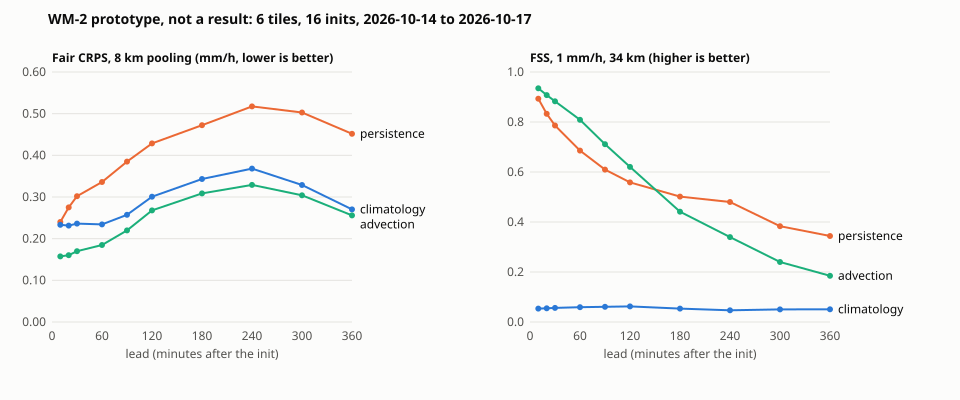

# WM-2 prototype

**A prototype, not a result.** 16 inits (00, 06, 12 and 18 UTC on 2026-10-14 to 2026-10-17), 6 tiles around the stations NY, CHI, MIA, OKC, SEA, LAX. The baselines were written after these days and the days were picked after looking at October's 24 h rain totals (rain in several tiles), so the sample is selected on the outcome; four days cannot support any comparison, and the intervals (resampling whole init dates) are printed to exercise the code. Generated by `uv run scripts/wm2_prototype.py` at 2026-10-30 19:46 UTC; numbers in `results/wm2/wm2_prototype.json`.

Task, truth and scores: [WM2_DRAFT.md](WM2_DRAFT.md). Each entry submits K = 20 joint samples of the MRMS rain rate (mm/h) on each tile's central 128 x 128 box at 0.02 deg (about 2 km; about 285 x 218 km at 40 N) for leads of 10 minutes to 6 hours; truth is the MRMS PrecipRate frame valid at each lead. Every score is computed on the same pixels for every entry.

## Entries

| Entry | What it is | Reads |
| --- | --- | --- |
| `persistence` | the latest frame before the init (init - 10 min), the same in every sample | 3 frames |
| `climatology` | the sequences observed at the same time of day in the past four years, offsets up to two days (20 analogues) | 200 frames |
| `advection` | the latest frame moved along one cross-correlation motion vector per tile, perturbed per sample | 3 frames |

## How much rain there was

Share of scored pixels at or above 0.1 mm/h, by lead (pooled over inits and tiles): 10 min 0.09, 20 min 0.08, 30 min 0.08, 60 min 0.08, 90 min 0.08, 120 min 0.08, 180 min 0.09, 240 min 0.09, 300 min 0.10, 360 min 0.09. 15,630,336 pixel-leads were scored, the same for every entry.

## Fair CRPS (mm/h) by pooling scale and lead

Fair CRPS of the rain rate averaged over s x s pixels (1, 4, 16: 2, 8 and 32 km), mean over pooled cells, date-block 95% interval. Lower is better.

**2 km**

| Lead (min) | `persistence` | `climatology` | `advection` |
| --- | --- | --- | --- |
| 10 | 0.283 [0.203, 0.375] | 0.234 [0.157, 0.311] | 0.176 [0.114, 0.262] |
| 20 | 0.311 [0.220, 0.413] | 0.232 [0.154, 0.311] | 0.174 [0.109, 0.267] |
| 30 | 0.334 [0.232, 0.439] | 0.237 [0.150, 0.324] | 0.182 [0.108, 0.277] |
| 60 | 0.362 [0.251, 0.474] | 0.235 [0.144, 0.327] | 0.194 [0.118, 0.285] |
| 90 | 0.409 [0.269, 0.549] | 0.258 [0.142, 0.374] | 0.227 [0.133, 0.328] |
| 120 | 0.450 [0.275, 0.625] | 0.302 [0.138, 0.466] | 0.273 [0.138, 0.409] |
| 180 | 0.492 [0.308, 0.675] | 0.344 [0.159, 0.529] | 0.314 [0.163, 0.466] |
| 240 | 0.535 [0.340, 0.757] | 0.369 [0.187, 0.578] | 0.335 [0.187, 0.503] |
| 300 | 0.515 [0.345, 0.684] | 0.330 [0.184, 0.476] | 0.309 [0.183, 0.434] |
| 360 | 0.463 [0.338, 0.608] | 0.272 [0.175, 0.368] | 0.259 [0.171, 0.347] |

**8 km**

| Lead (min) | `persistence` | `climatology` | `advection` |
| --- | --- | --- | --- |
| 10 | 0.240 [0.170, 0.320] | 0.233 [0.156, 0.310] | 0.158 [0.100, 0.239] |
| 20 | 0.275 [0.194, 0.365] | 0.231 [0.153, 0.310] | 0.160 [0.097, 0.253] |
| 30 | 0.302 [0.209, 0.395] | 0.236 [0.149, 0.323] | 0.170 [0.099, 0.266] |
| 60 | 0.336 [0.233, 0.439] | 0.234 [0.143, 0.326] | 0.185 [0.112, 0.276] |
| 90 | 0.385 [0.255, 0.515] | 0.257 [0.142, 0.373] | 0.220 [0.129, 0.322] |
| 120 | 0.429 [0.264, 0.593] | 0.301 [0.136, 0.465] | 0.268 [0.136, 0.400] |
| 180 | 0.472 [0.299, 0.646] | 0.343 [0.158, 0.528] | 0.309 [0.161, 0.457] |
| 240 | 0.517 [0.332, 0.729] | 0.368 [0.185, 0.577] | 0.329 [0.186, 0.493] |
| 300 | 0.503 [0.338, 0.667] | 0.329 [0.183, 0.475] | 0.304 [0.181, 0.427] |
| 360 | 0.452 [0.332, 0.594] | 0.270 [0.173, 0.367] | 0.256 [0.169, 0.343] |

**32 km**

| Lead (min) | `persistence` | `climatology` | `advection` |
| --- | --- | --- | --- |
| 10 | 0.147 [0.108, 0.193] | 0.229 [0.153, 0.306] | 0.095 [0.059, 0.146] |
| 20 | 0.182 [0.134, 0.234] | 0.228 [0.149, 0.306] | 0.112 [0.069, 0.179] |
| 30 | 0.222 [0.153, 0.291] | 0.233 [0.146, 0.319] | 0.133 [0.073, 0.215] |
| 60 | 0.266 [0.188, 0.344] | 0.231 [0.139, 0.322] | 0.153 [0.091, 0.238] |
| 90 | 0.323 [0.215, 0.430] | 0.254 [0.138, 0.369] | 0.197 [0.113, 0.301] |
| 120 | 0.372 [0.235, 0.509] | 0.297 [0.132, 0.461] | 0.252 [0.127, 0.377] |
| 180 | 0.421 [0.272, 0.570] | 0.339 [0.154, 0.525] | 0.294 [0.155, 0.433] |
| 240 | 0.472 [0.308, 0.659] | 0.364 [0.181, 0.573] | 0.313 [0.180, 0.466] |
| 300 | 0.468 [0.315, 0.620] | 0.324 [0.179, 0.470] | 0.292 [0.175, 0.410] |
| 360 | 0.418 [0.313, 0.557] | 0.266 [0.170, 0.362] | 0.246 [0.163, 0.329] |

## Energy score and station pixel

Fair energy score of each tile's field averaged to 32 km (64 numbers, mm/h), mean over (init, tile) rows; and fair CRPS at the station's own pixel (mm/h). Rows are the same for every entry.

| Lead (min) | Rows | `persistence` energy | `climatology` energy | `advection` energy | `persistence` station | `climatology` station | `advection` station |
| --- | --- | --- | --- | --- | --- | --- | --- |
| 10 | 96 | 2.688 | 3.777 | 1.719 | 0.4750 | 0.1721 | 0.2576 |
| 20 | 96 | 3.191 | 3.701 | 1.978 | 0.4625 | 0.2208 | 0.2320 |
| 30 | 96 | 3.747 | 3.831 | 2.277 | 0.6250 | 0.2836 | 0.2612 |
| 60 | 96 | 4.378 | 3.675 | 2.496 | 0.5010 | 0.1609 | 0.0563 |
| 90 | 96 | 5.187 | 4.137 | 3.190 | 0.6031 | 0.0791 | 0.0662 |
| 120 | 96 | 5.885 | 4.753 | 3.920 | 0.6615 | 0.5390 | 0.4833 |
| 180 | 96 | 6.982 | 5.511 | 4.728 | 0.4583 | 0.7270 | 0.7095 |
| 240 | 90 | 7.380 | 5.731 | 4.765 | 0.8522 | 0.4065 | 0.3650 |
| 300 | 96 | 7.251 | 5.189 | 4.484 | 0.8135 | 0.2799 | 0.2747 |
| 360 | 96 | 6.662 | 4.295 | 3.895 | 1.1135 | 0.6318 | 0.6321 |

## Fractions skill score

FSS (Roberts and Lean 2008) of the ensemble's neighbourhood exceedance probability, summed over inits and tiles before the ratio. Higher is better; 1 is perfect. Not proper, so reported, never ranked on.

| Lead (min) | `persistence` 1 mm/h, 2 / 10 / 34 km | `climatology` 1 mm/h, 2 / 10 / 34 km | `advection` 1 mm/h, 2 / 10 / 34 km |
| --- | --- | --- | --- |
| 10 | 0.57 / 0.74 / 0.89 | 0.03 / 0.04 / 0.05 | 0.70 / 0.82 / 0.93 |
| 20 | 0.52 / 0.68 / 0.83 | 0.03 / 0.04 / 0.05 | 0.68 / 0.80 / 0.91 |
| 30 | 0.48 / 0.63 / 0.79 | 0.03 / 0.04 / 0.06 | 0.65 / 0.77 / 0.88 |
| 60 | 0.42 / 0.55 / 0.69 | 0.04 / 0.05 / 0.06 | 0.58 / 0.70 / 0.81 |
| 90 | 0.36 / 0.48 / 0.61 | 0.04 / 0.05 / 0.06 | 0.50 / 0.60 / 0.71 |
| 120 | 0.33 / 0.44 / 0.56 | 0.04 / 0.05 / 0.06 | 0.43 / 0.52 / 0.62 |
| 180 | 0.31 / 0.40 / 0.50 | 0.04 / 0.04 / 0.05 | 0.31 / 0.37 / 0.44 |
| 240 | 0.30 / 0.39 / 0.48 | 0.03 / 0.04 / 0.05 | 0.23 / 0.29 / 0.34 |
| 300 | 0.23 / 0.30 / 0.38 | 0.03 / 0.04 / 0.05 | 0.16 / 0.20 / 0.24 |
| 360 | 0.20 / 0.27 / 0.34 | 0.03 / 0.04 / 0.05 | 0.11 / 0.15 / 0.18 |

| Lead (min) | `persistence` 4 mm/h, 2 / 10 / 34 km | `climatology` 4 mm/h, 2 / 10 / 34 km | `advection` 4 mm/h, 2 / 10 / 34 km |
| --- | --- | --- | --- |
| 10 | 0.37 / 0.60 / 0.80 | 0.01 / 0.01 / 0.02 | 0.52 / 0.71 / 0.87 |
| 20 | 0.31 / 0.50 / 0.69 | 0.01 / 0.01 / 0.02 | 0.47 / 0.65 / 0.81 |
| 30 | 0.27 / 0.43 / 0.61 | 0.01 / 0.01 / 0.02 | 0.41 / 0.59 / 0.75 |
| 60 | 0.18 / 0.29 / 0.45 | 0.01 / 0.02 / 0.02 | 0.29 / 0.43 / 0.60 |
| 90 | 0.15 / 0.24 / 0.38 | 0.01 / 0.01 / 0.02 | 0.22 / 0.33 / 0.47 |
| 120 | 0.15 / 0.24 / 0.35 | 0.01 / 0.02 / 0.03 | 0.18 / 0.26 / 0.36 |
| 180 | 0.15 / 0.24 / 0.35 | 0.01 / 0.01 / 0.02 | 0.15 / 0.21 / 0.28 |
| 240 | 0.14 / 0.21 / 0.29 | 0.01 / 0.01 / 0.01 | 0.14 / 0.20 / 0.27 |
| 300 | 0.08 / 0.12 / 0.18 | 0.01 / 0.01 / 0.01 | 0.09 / 0.14 / 0.20 |
| 360 | 0.08 / 0.13 / 0.19 | 0.01 / 0.01 / 0.02 | 0.06 / 0.10 / 0.16 |

## Cost of this run

- Capture: 1808 frames requested, 0 fetched, 2 not in the bucket, 0 MB downloaded in 1 s (6 threads, one laptop CPU; 0 means already captured).
- Stored: 1806 frames of 6 tiles in 44.5 MB of compressed uint16.
- Predict, all inits: `persistence` 0 s, `climatology` 1 s, `advection` 21 s. One forecast is 20 x 6 x 10 x 128 x 128 float32, 79 MB before compression.

## Findings (about the pipeline)

1. **Data volume is small.** One CONUS PrecipRate file is about 0.5 MB gzipped (350 MB a day at
   the native 2-minute cadence). At a 10-minute cadence a day is 144 files, about 64 MB to
   download and 12 s to fetch, decode and cut on one laptop; the 19 station tiles of that day
   (2026-10-29) stored in 8.1 MB. A 56-day round is about 3.6 GB downloaded and 0.5 GB kept.
2. **The archive is the backup.** Unlike Open-Meteo's ensembles, MRMS is kept on the bucket
   back to 2020-10-14, so a missed capture loses nothing and an analogue climatology can be
   built from past years without having captured them. Over the 30 days to 2026-10-29, 18 of
   4,320 ten-minute frames were absent (0.4%), clustered in short outages (9 on 2026-10-07);
   in this sample 2 of 1,808 frames were absent, which drops one lead of the first init for
   every entry. One request to the bucket timed out during the TLS handshake in the first run;
   reads now retry transient network errors (an absent file is an answer, not retried).
3. **The context box limits long leads.** `advection` beats `persistence` on pooled CRPS at
   every lead and on FSS for the first 2 to 3 h, then falls below it: rain moved in from outside the
   256-pixel context box is unknown and set to zero, and with 128 km of margin each side and
   tile motions of 40 to 70 km/h (median, rainy tiles) the box empties after 2 to 3 h. A 6 h
   lead needs about 400 km of upstream context; the draft serves a 512-pixel box (about
   1,000 km) and makes 3 h the primary horizon (WM2_DRAFT.md).
4. **Per-pixel CRPS rewards dry hedging.** About 8% of scored pixels were wet. `climatology`
   has almost no skill on FSS (about 0.05) yet is close to `advection` on pixel CRPS at long
   leads, because samples that are mostly dry are cheap where it is dry. The draft ranks on
   the energy score of the 32 km field and on threshold-weighted CRPS, and reports pixel CRPS
   and FSS.
5. **Forecasts are the cost driver, not inputs.** One forecast of 6 tiles is 79 MB as
   float32; quantised to 0.1 mm/h (MRMS's own precision) and compressed it was 1.2 to 2.6 MB.
   At 19 tiles and four inits a day a round is about 1 to 2 GB per entry, which fits release
   assets; the draft makes uint16 tenths of mm/h the submission format.
6. **CPU is enough for the baselines and the scoring.** Every number here was computed on
   one laptop CPU; a learned entry (e.g. DGMR) would need a GPU to train, not to score.
7. **Hashes, not yet the sealed runner.** Every day file is checked against its manifest's
   sha256 before use and each forecast's sha256 is recorded, but the baselines were called
   directly: WM-1's manifest runner accepts only the inputs `truth` and `ensembles`, and WM-1
   is left unchanged. Admitting `radar` there is part of building WM-2 proper.

## Data

Radar: NOAA Multi-Radar/Multi-Sensor System (MRMS; Zhang et al. 2016), product PrecipRate, read from the NOAA Open Data Dissemination bucket `s3://noaa-mrms-pds` on the AWS Open Data Registry. NOAA data disseminated through NODD are open to the public and can be used as desired; NOAA requests attribution. The values here were modified (averaged to 0.02 deg, cut to tiles, quantised to 0.1 mm/h, forecast and scored) by Physical Reasoning; they are not original, unaltered NOAA data, and nothing here is endorsed by NOAA. Only aggregate scores are published; the tiles stay under data/ (gitignored).
